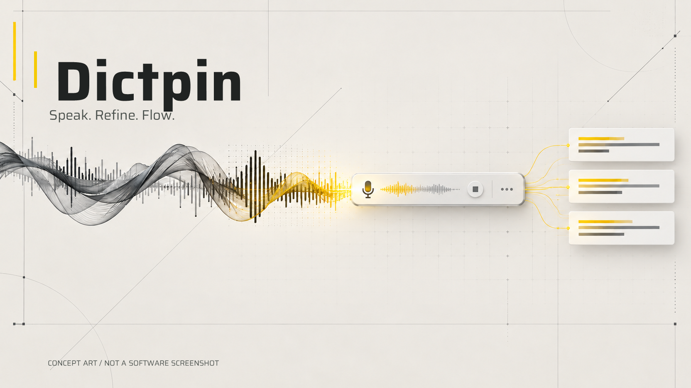
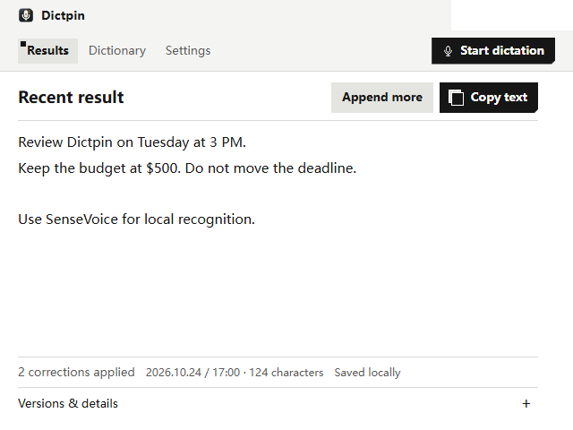
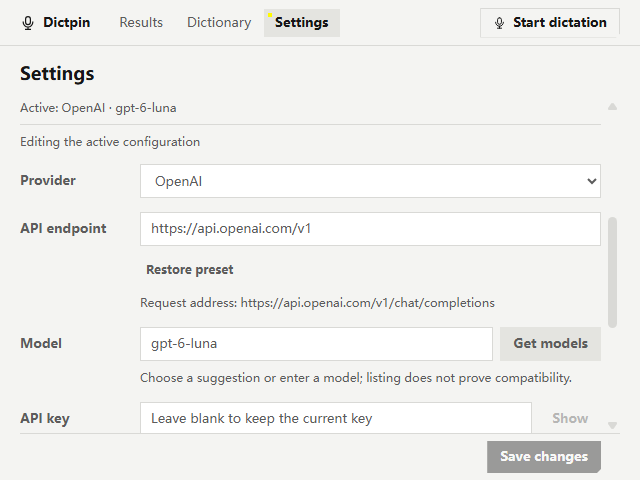

<h1 align="center">Dictpin v0.2.2-dev.32</h1>

<p align="center">
  <strong>La dictée de bureau en petit format. Parlez, gardez la maîtrise de vos mots, puis passez à la suite.</strong>
</p>

<p align="center">
  <a href="https://github.com/electron/electron/releases/tag/v44.8.0"></a>
  <a href="../../app/renderer/dictation-app.js"></a>
  <a href="../../native/LocalAsrWorker.Local03.cs"></a>
  <a href="../API_CONFIGURATION.md"></a>
  <a href="../INSTALL.md"></a>
  <a href="../../LICENSE"></a>
</p>

<p align="center">
  <a href="../../README.md">English</a> · <a href="README.zh-CN.md">简体中文</a> · <strong>Français</strong> · <a href="README.ja.md">日本語</a> · <a href="README.ko.md">한국어</a> · <a href="README.ms.md">Bahasa Melayu</a>
</p>



**Illustration conceptuelle générée par IA : ce n’est ni une capture du logiciel ni une preuve de fonctions implémentées.**

Dictpin est une version de développement d’une application Windows de transcription vocale, construite avec Electron, la reconnaissance locale SenseVoice, des règles explicites de dictionnaire personnel et un nettoyage facultatif du texte par un service compatible. Pour les messages courts, les notes, les noms et les termes techniques : démarrez, parlez, relisez, copiez.

> **Version de développement distribuée sous forme de code source.** Dépôt : [chenjinxian1/Dictpin](https://github.com/chenjinxian1/Dictpin). Le code et les ressources originales du projet sont sous licence MIT, au nom de chenjinxian1 ; les composants tiers conservent leurs propres conditions. Aucun installateur ni téléchargement de version n’est validé. Le nom Dictpin a fait l’objet d’une première recherche d’homonymes, sans garantie de disponibilité juridique de la marque. Les identifiants du paquet et les chemins de données restent inchangés. Ce projet est indépendant de Typeless et n’a aucun lien officiel avec lui.

## Découvrir l’application

### Interface principale · affichage en anglais



Rendu réel de l’interface Electron de production, en mode d’affichage anglais facultatif, avec du texte de démonstration anglais et des adaptateurs système simulés. Le texte préchargé passe par les véritables règles du dictionnaire local ; aucun microphone ni aucune reconnaissance acoustique n’a été utilisé.

### Configuration API · affichage en anglais



Exemple de sélection du fournisseur, d’adresse et de modèle ; le champ de clé API est vide. Seules des réponses simulées ont été utilisées, sans connexion réelle, appel facturé ni mesure de latence. Voir les [conditions de capture](../SCREENSHOTS.md).

## Fonctions déjà disponibles

- **Reconnaissance locale :** SenseVoice sur processeur, avec détection d’activité vocale Silero ; aucun basculement automatique vers une reconnaissance dans le cloud.
- **Corrections explicites du dictionnaire :** enregistrez un terme correct et, si nécessaire, ses erreurs de transcription fréquentes. Les remplacements locaux s’effectuent en un seul passage, en privilégiant la règle correspondante la plus longue, sans déduction d’homophones ni apprentissage automatique. Vous pouvez examiner et annuler les corrections.
- **Texte disponible avant la fin du nettoyage :** modifiez ou copiez immédiatement. Ces deux actions arrêtent le nettoyage en attente ; une réponse tardive ne peut plus remplacer cette version. Le texte original de la reconnaissance reste accessible.
- **Reprise explicite :** le texte terminé est conservé ; le PCM non traité, borné et uniquement en mémoire, peut être repris pendant 30 secondes après annulation ou cinq minutes après échec, sans nettoyage distant.
- **Un espace de travail compact :** résultat, dictionnaire, paramètres et petite barre flottante d’enregistrement. Les thèmes clair et sombre, le contraste élevé, la réduction des animations et le focus clavier sont déjà implémentés.
- **Nettoyage léger facultatif :** ponctuation, paragraphes et suppression des hésitations par un service texte Chat Completions. En cas d’échec ou au bout de 12 secondes, le brouillon corrigé localement reste utilisable.

Les avantages concrets sont la maîtrise du texte, des règles de dictionnaire utilisables hors ligne et la possibilité de récupérer un enregistrement sans devoir recommencer immédiatement. Nous ne revendiquons aucune précision, latence, consommation mémoire ou supériorité concurrentielle universelle. La traduction, les questions-réponses, l’enrichissement du texte, un grand tableau de bord d’historique ne font pas partie du projet.

## Déroulement

```text
Démarrage explicite → microphone sélectionné → reconnaissance locale
                    → règles explicites du dictionnaire → nettoyage facultatif
                    → relecture / modification → copie explicite
```

Une seule session et un seul décodeur local à la fois. L’arrêt termine les segments acceptés avant le nettoyage et la livraison facultatifs. Modifier ou copier pendant le nettoyage l’arrête. `Ctrl+Enter` copie tout le résultat et `Ctrl+C` conserve la copie de sélection habituelle. Le raccourci de copie reste non attribué par défaut.

## Dictée longue, ajout et collage protégé

L’enregistrement alimente désormais un pipeline local borné. Les segments privilégient les pauses et durent au plus 20 secondes ; un seul moteur SenseVoice les décode dans l’ordre, avec aperçu et sauvegarde du texte pendant la dictée. La limite de session de 60 secondes est supprimée. Des garde-fous arrêtent la session à 30 minutes, 100 000 caractères ou en cas d’accumulation ; l’audio accepté n’est pas tronqué silencieusement.

**Append more** conserve le brouillon précédent, y compris ses corrections manuelles, et ajoute l’enregistrement suivant. Une préférence permet aussi l’ajout au raccourci. Le texte antérieur n’est pas nettoyé à nouveau ; la livraison automatique ne transmet que le nouveau suffixe. Copier porte toujours sur le résultat complet. Les aperçus restent en lecture seule jusqu’à la fin du décodage ; pendant le nettoyage, modifier ou copier l’arrête.

Le **collage protégé est désactivé par défaut**. Compilez l’outil Windows séparé, activez l’option et enregistrez, puis lancez la dictée par raccourci depuis un champ modifiable compatible. Après un arrêt explicite, un seul collage est tenté. Les mots de passe, terminaux, applications élevées, contrôles non vérifiables et changements de focus, curseur, processus ou presse-papiers le bloquent. Un retour au champ initial n’est autorisé qu’après un arrêt explicite dans Dictpin ; aucune application sans rapport n’est forcée au premier plan. Un démarrage dans l’application reste manuel.

La livraison remplace le presse-papiers sans lire ni sauvegarder son contenu précédent. L’envoi des touches ne prouve pas leur réception. Si le résultat est incertain, vérifiez le champ d’origine ; aucune répétition automatique. Démarrage, ajout et édition sont bloqués pendant la livraison. Les arrêts de protection et la récupération n’autorisent pas de collage.

Le texte terminé est sauvegardé. Seule la collection bornée de PCM **non traité** est récupérable en mémoire : 30 secondes après annulation, cinq minutes au plus après échec. La reprise est explicite, sans nettoyage distant ; ce n’est pas une archive de toute la dictée. Expiration, effacement et fermeture suppriment cet audio.

Les découpes forcées peuvent affecter les mots sans pause. Microphones réels, contrôles natifs, focus, presse-papiers et performances comparatives nécessitent une validation séparée. Aucune supériorité sur Typeless n’est revendiquée. Voir le [journal des modifications](../../CHANGELOG.md).

## Démarrage rapide : environnement de développement

**Plateforme cible actuelle : Windows x64.** Installez Node.js **24 ou ultérieur**. Préparez la distribution externe complète d’Electron **44.8.0**, les bibliothèques partagées sherpa-onnx **1.13.8**, le modèle SenseVoice int8 et ses tokens, le modèle Silero VAD et le programme natif Local03 séparé. Ces ressources ne sont pas incluses. Respectez l’arborescence exacte et utilisez les sources officielles indiquées dans [Installation](../INSTALL.md).

Depuis la racine du dépôt, une fois les ressources prêtes :

```powershell
.\native\build-local03.cmd
.\native\build-delivery.cmd
npm run doctor
npm run check
node scripts/package-inputs.cjs
npm run dev
```

Les scripts à la racine utilisent les modules intégrés de Node ; aucune installation de dépendances n’est nécessaire à la racine. `doctor` contrôle l’arborescence existante, sans valider une nouvelle installation ni la qualité de reconnaissance. `dev` ouvre volontairement un profil de développement sans lancer d’enregistrement. N’utilisez pas les anciens scripts de démarrage ou de reprise de session.

Pour une **utilisation locale sans API**, laissez **轻整理** (nettoyage léger) désactivé. Ouvrez **设置** (Paramètres), choisissez le microphone effectivement utilisé par l’Enregistreur Windows, cliquez sur **保存更改** (Enregistrer les modifications), puis démarrez explicitement la dictée. Un choix de microphone non enregistré n’est pas actif. Arrêtez, vérifiez et copiez le texte. Configurez un raccourci seulement si vous le souhaitez.

`npm run check` vérifie la syntaxe de l’application, les dépendances locales, les fichiers nécessaires à la distribution et la documentation. Les tests, mesures de performance, anciennes interfaces et outils internes de publication restent hors de ce dépôt. Consultez le [statut de validation et de compilation](../INSTALL.md#validation-and-build-status). Aucune commande de création d’un installateur n’est présentée comme validée.

## Configuration facultative de l’API

Dans **设置 → 模型连接** (Paramètres → Connexion du modèle), choisissez **Qwen, DeepSeek, OpenAI, SiliconFlow, service local compatible ou Personnalisé**. Les préréglages renseignent l’adresse et proposent des modèles ; Qwen propose `qwen-flash` ou `qwen-plus` et exige une région et un espace de travail explicites ; SiliconFlow ne présélectionne aucun modèle. Chaque fournisseur/région conserve sa configuration et sa clé, mais un seul est actif. La sélection et la saisie modifient uniquement le brouillon. **Enregistrer les modifications**, à l’arrêt des tâches, enregistre et active l’ensemble ; un échec préserve l’ancienne configuration, sans redémarrage ni requête automatique.

**Tester le nettoyage** vérifie le brouillon API non enregistré avec un exemple fictif bilingue, les règles du nettoyage réel et un délai de 12 secondes. Modifier l’adresse, le modèle ou la clé invalide le résultat précédent. **Obtenir les modèles** est une action explicite, limitée à 10 secondes, 500 modèles et 2 MiB. Si elle échoue ou n’est pas prise en charge, les suggestions et la saisie manuelle restent disponibles. Une liste ou un exemple réussi ne garantit pas la qualité générale.

Les clés sont liées à leur configuration et à leur point d’accès. Un champ vide conserve la clé de ce profil ; **Supprimer la clé** reste annulable avant l’enregistrement. Les nouvelles clés restent en session sauf choix du chiffrement système. Un changement d’adresse exige un remplacement ou une suppression explicite ; un échec de chiffrement ou d’écriture annule l’enregistrement. Si la clé manque, la dictée continue localement pour ce passage, sans changer la préférence ni le fournisseur.

Seul **Chat Completions texte non diffusé en continu** est pris en charge ; aucune configuration API par variable d’environnement ou `.env`. Les préréglages ont été vérifiés dans la documentation le 2026-10-28, sans validation de compte réel. Aucun serveur texte local n’est fourni. Voir [Configuration de l’API](../API_CONFIGURATION.md) pour les champs, clés, limites régionales et dépannage. **Les tests et nouvelles tentatives délibérées peuvent être facturés ; annuler ne garantit pas l’arrêt de la facturation distante.**

## Confidentialité et stockage local

- La reconnaissance locale et les corrections du dictionnaire ne nécessitent aucune API. Le produit actuel ne crée pas de nouveaux fichiers d’enregistrement. La récupération audio utilise une mémoire temporaire ; l’expiration, l’effacement et la fermeture de l’application la vident. La récupération après un plantage n’est pas garantie.
- **Le dernier résultat est enregistré localement en texte clair**, avec le texte original et le texte modifié, même lorsque l’historique de plusieurs éléments est désactivé. Il n’existe ni expiration automatique des transcriptions ni option permettant de désactiver cette conservation. Les données de développement se trouvent dans `work/dev/profile/`, exclu de Git ; ne les ajoutez jamais à un commit.
- L’activation du nettoyage envoie au service configuré la transcription corrigée et une liste de taille limitée de termes corrects enregistrés dans le dictionnaire. L’audio brut et les variantes erronées ne sont pas inclus. Les règles de conservation et de facturation du fournisseur s’appliquent.
- Les nouvelles clés restent limitées à la session, sauf si leur conservation chiffrée est choisie. Les clés enregistrées utilisent le stockage Electron adossé au système d’exploitation ; aucun repli en texte clair n’est prévu si ce stockage est indisponible. Cette protection n’arrête pas un logiciel malveillant agissant sous votre compte système.
- Les relevés d’utilisation contiennent des métadonnées de requête, modèle, durée et tokens, sans corps de texte ni clé. L’absence de données d’utilisation ou de tarification signifie que le coût est inconnu, pas qu’il est nul.

Lisez [Confidentialité](../PRIVACY.md) avant d’utiliser du contenu privé. La reconnaissance locale ne signifie pas que le nettoyage facultatif n’envoie rien ou qu’aucun texte n’est jamais écrit sur disque.

## Langues, limites et vérification

L’interface utilise par défaut le **chinois simplifié** et propose un **affichage anglais facultatif**, utilisé dans ces exemples. La documentation en six langues ne signifie pas que l’interface ou la reconnaissance prend en charge ces six langues. Le projet SenseVoice d’origine indique le mandarin, le cantonais, l’anglais, le japonais et le coréen. Une évaluation antérieure sur fichiers fixes couvrait le mandarin et l’anglais ; nous ne revendiquons pas la reconnaissance du français ou du malais.

L’interface suit la langue d’affichage de Windows : chinois sur un système chinois, anglais sinon. Modifiez-la dans Paramètres → Langue de l’interface (après redémarrage), ou forcez-la en développement avec `npm run dev -- --ui-language=en` ou `--ui-language=zh-CN`. Ce choix ne modifie que l’affichage, pas les transcriptions ni le dictionnaire.

Ce dépôt contient le code de l’application et sa documentation. Les jeux de test internes et rapports de performance ne sont pas inclus. Les raccourcis globaux, le presse-papiers système, les changements de microphone, le focus, les écrans multiples, le DPI Windows, les services réels et l’installation sur une machine vierge nécessitent encore des validations distinctes.

Les anciens tests de performance concernent leur machine et leur corpus, sans promettre une vitesse ou une précision universelles. L’inspection de préparation à la distribution indique explicitement **`distributionReady:false`**.

## Dépannage

| Problème | Vérifications à effectuer |
| --- | --- |
| Ressource d’exécution ou modèle manquant | Lancez `npm run doctor` ; vérifiez l’arborescence externe complète, les versions et les mentions de licence. |
| Aucun mouvement du niveau ou aucune parole détectée | Choisissez par son nom le microphone qui fonctionne réellement, enregistrez, vérifiez les permissions Windows et le mode muet, puis lancez volontairement un enregistrement. L’entrée système par défaut peut être différente. |
| Aucune API configurée | Désactivez le nettoyage ; la reconnaissance locale et les règles du dictionnaire restent utilisables. |
| 401/403 ou 404 | Vérifiez la clé, la région, les droits, l’identifiant du modèle et l’adresse Chat Completions. Ne collez jamais de clé dans un ticket. |
| Limitation de débit ou délai dépassé | Conservez le texte préservé. Relancez volontairement ; la requête précédente peut malgré tout être facturée. |
| Échec d’enregistrement des modifications | Gardez le brouillon, copiez le texte important et vérifiez l’espace disque ainsi que les droits d’écriture avant de réessayer. |
| Erreur TLS ou réseau | Vérifiez l’hôte officiel, l’horloge système, la chaîne de confiance et le pare-feu. Ne désactivez jamais la vérification des certificats. |

## Feuille de route et contributions

Prochaines étapes : configuration et distribution sur une machine vierge, validation d’un plus grand nombre de périphériques, commandes de conservation et de suppression des transcriptions, puis améliorations de reconnaissance étayées par des mesures. Il s’agit de projets, pas de fonctions déjà disponibles. L’application restera un outil de dictée compact.

Lisez [CONTRIBUTING.md](../../CONTRIBUTING.md) pour les vérifications locales sûres et [SECURITY.md](../../SECURITY.md) pour les limites du signalement. [CHANGELOG.md](../../CHANGELOG.md) décrit les modifications du code source.

## Licence et remerciements

Le code original, la documentation et les ressources originales du projet sont proposés sous la [licence MIT](../../LICENSE), copyright 2026 chenjinxian1. La [portée des licences](../../THIRD_PARTY_NOTICES.md) distingue ces éléments des polices, déclarations générées, bibliothèques et modèles tiers.

Les composants tiers conservent leurs propres conditions : Electron/Chromium, sherpa-onnx/ONNX Runtime, les poids SenseVoice, Silero VAD et Saira. Les conditions des modèles sont distinctes d’une éventuelle licence du code de l’application. Lisez [THIRD_PARTY_NOTICES.md](../../THIRD_PARTY_NOTICES.md). Merci à leurs équipes de maintenance et aux contributeurs de FLEURS. L’orientation industrielle sobre s’inspire d’[endfield-ui-skill](https://github.com/hhikr/endfield-ui-skill) ; aucun personnage, logo ou visuel de jeu n’est utilisé comme élément de marque.
